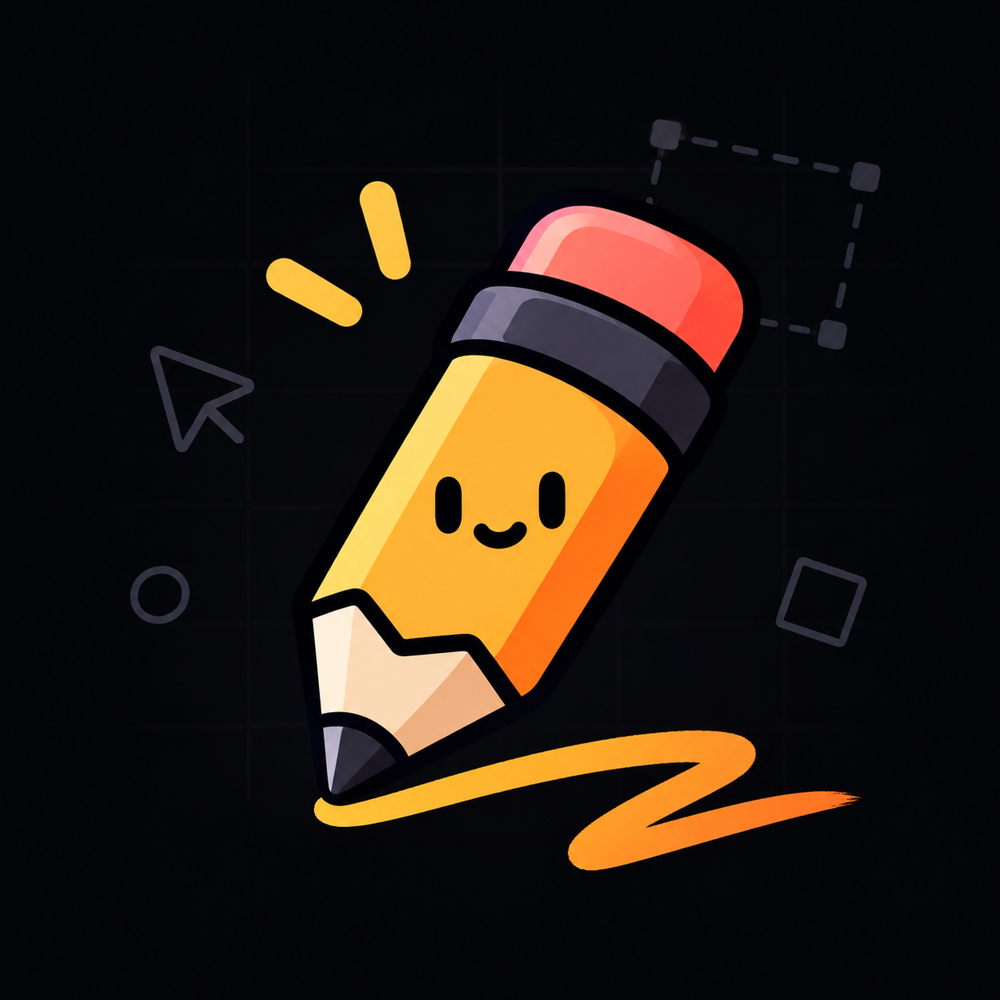

<div align="center">
  
  <h1>Scribl</h1>
  <p><strong>A high-performance infinite canvas sketching & whiteboard app built for mouse and drawing tablets.</strong></p>

<p>
    <a href="https://tauri.app/"></a>
    <a href="https://react.dev/"></a>
    <a href="https://www.typescriptlang.org/"></a>
    <a href="https://vite.dev/"></a>
    
  </p>
</div>

---

## 🌟 Overview

**Scribl** combines the diagramming flexibility of Excalidraw and Tldraw with the organic, low-latency feel of native tablet note-taking applications (Apple Notes, Concepts, Goodnotes).

Engineered from the ground up to support high-refresh-rate displays (120Hz–240Hz), Scribl decouples high-frequency stylus events from React's state lifecycle to deliver sub-8ms inking latency, pressure sensitivity, and strict palm rejection.

---

## ✨ Features

- ⚡ **Ultra-Low Latency Dual Canvas (240Hz Ready)**:
  - **Active Scratch Layer**: Initialized with `{ desynchronized: true, alpha: true }` bypassing window compositor double-buffering for immediate front-buffer drawing.
  - **Committed Layer**: Frustum-culled batch vector rendering of cached `Path2D` strokes to maintain 60–120+ FPS across thousands of elements.
- 🖊️ **Tablet & Stylus Native**:
  - Pressure-sensitive stroke thickness using `perfect-freehand`.
  - Event coalescing via `getCoalescedEvents()` preventing angular stepping during fast scribbling.
  - Hardware stylus eraser flip recognition (`e.buttons === 32`).
  - Strict palm rejection (touch inputs pan/zoom without leaving accidental pen marks).
- 🌌 **Infinite 2D Canvas**:
  - Smooth pan and zoom from **10% to 800%** with world coordinate transforms strictly anchored to cursor position.
  - Dynamic scaling dot-grid background.
  - **Spacebar-to-Pan**: Hold `Space` and drag to glide across the canvas with custom grab cursor feedback.
- 🧽 **Minimalist Eraser Trail**:
  - Clean slate-gray trailing streak that tapers and smoothly dissolves over ~180ms.
  - Circular reticle cursor matching the eraser's hit-detection footprint.
- 🎨 **Glassmorphic Floating HUD**:
  - Bottom-docked floating island toolbar (`Select`, `Pen`, `Eraser`).
  - Contextual color palette (8 curated swatches) and 4 discrete stroke thicknesses.
  - Zoom HUD with quick presets (`100% / Shift+0`, `+`, `-`).
  - Non-blocking two-step canvas clear action.
- 🔄 **Command-Based History**:
  - Multi-level Undo (`Cmd+Z`) and Redo (`Cmd+Shift+Z` / `Cmd+Y`) tracking stroke additions, deletions, and translations.
- 💾 **Persistence & High-Res Export**:
  - Debounced autosave to local storage.
  - Open & Save native `.scribl` JSON documents.
  - 2x high-resolution PNG export bounded tightly to content.

---

## ⌨️ Keyboard Shortcuts

| Shortcut                                 | Action                      |
| ---------------------------------------- | --------------------------- |
| `P` or `2`                               | **Pen Tool**                |
| `E` or `3`                               | **Eraser Tool**             |
| `V` or `1`                               | **Select / Move Tool**      |
| `Space` + Drag                           | **Pan Canvas**              |
| `Cmd/Ctrl + Z`                           | **Undo**                    |
| `Cmd/Ctrl + Shift + Z` or `Cmd/Ctrl + Y` | **Redo**                    |
| `Backspace` or `Delete`                  | **Delete Selected Strokes** |
| `+` / `=`                                | **Zoom In**                 |
| `-`                                      | **Zoom Out**                |
| `Shift + 0`                              | **Reset Zoom (100%)**       |
| Mouse Wheel                              | **Cursor-Anchored Zoom**    |

---

## 🚀 Getting Started

### Prerequisites

Ensure you have the following installed on your machine:

- [Node.js](https://nodejs.org/) (v18+)
- [pnpm](https://pnpm.io/) (`npm install -g pnpm`)
- [Rust](https://www.rust-lang.org/tools/install) (for Tauri v2 desktop integration)

### Installation

1. Clone the repository:

   ```bash
   git clone https://github.com/your-username/scribl.git
   cd scribl
   ```

2. Install dependencies:
   ```bash
   pnpm install
   ```

### Development

Run the desktop application in Tauri development mode with hot-module replacement:

```bash
pnpm tauri dev
```

_(or run `cargo tauri dev`)_

To run purely in the browser for web testing:

```bash
pnpm dev
```

### Running Tests

Execute the unit test suite with Vitest:

```bash
pnpm test
```

Run TypeScript verification:

```bash
pnpm tsc --noEmit
```

### Building for Production (macOS App Bundle)

To build a standalone signed/packaged macOS bundle (`.app` and `.dmg`):

```bash
pnpm tauri build
```

Bundled artifacts will be located in:

```
src-tauri/target/release/bundle/macos/
```

---

## 🏛️ Architecture

```
src/
├── app/
│   ├── App.tsx                      # Root shell, global shortcuts & persistence sync
│   └── App.css                      # Global styles & canvas viewport containment
├── components/
│   ├── canvas/
│   │   ├── CanvasViewport.tsx       # Dual-layer canvas viewport container & pointer listeners
│   │   ├── InfiniteGrid.tsx         # Responsive background dot grid
│   │   └── SelectionOverlay.tsx     # SVG selection bounding box & marquee rectangle
│   └── ui/
│       ├── FloatingDock.tsx         # Bottom-center glassmorphic tool switcher
│       ├── StyleInspector.tsx       # Floating color & thickness palette
│       ├── TopHeader.tsx            # Brand bar, editable drawing title, file actions
│       └── ZoomHUD.tsx              # Bottom-right zoom percentage & controls
├── core/
│   ├── camera/
│   │   └── cameraMath.ts            # Screen <-> World coordinate mapping & cursor-anchored zoom
│   ├── engine/
│   │   ├── CanvasRenderer.ts        # Committed canvas frustum-culled vector batch renderer
│   │   ├── HitTester.ts             # Point-to-stroke distance & marquee intersection
│   │   ├── InkingEngine.ts          # perfect-freehand outline polygon & Path2D generator
│   │   └── ScratchRenderer.ts       # Low-latency 240Hz scratch canvas & eraser trail loop
│   ├── history/
│   │   ├── HistoryStack.ts          # Command pattern Undo/Redo manager
│   │   └── commands.ts              # Add, Delete, and Move commands
│   ├── input/
│   │   ├── PointerRouter.ts         # High-rate coalesced pointer router & palm rejection
│   │   └── ToolFSM.ts               # Interaction state machine
│   └── persistence/
│       ├── autoSave.ts              # LocalStorage debounced sync
│       └── fileIO.ts                # .scribl JSON serializer & high-res PNG exporter
├── stores/
│   ├── useCameraStore.ts            # Camera offset, zoom, and spacebar panning state
│   ├── useDocumentStore.ts          # Scene graph, z-index ordering, selection
│   └── useToolStore.ts              # Active tool, color, stroke thickness
└── types/
    ├── canvas.ts                    # Core element, stroke point & camera interfaces
    └── commands.ts                  # Command interfaces
```

---

## 📄 License

This project is licensed under the [MIT License](LICENSE).
