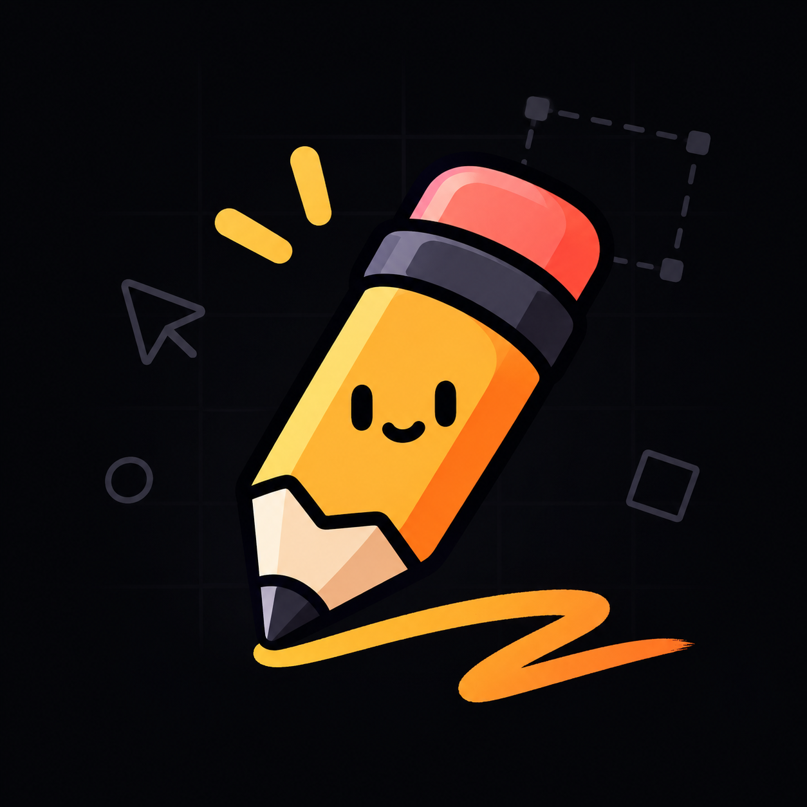

<div align="center">
  
  <h1>Scribl</h1>
  <p><strong>A high-performance infinite canvas sketching & whiteboard app built for mouse, stylus, and drawing tablets.</strong></p>

<p>
    <a href="https://github.com/shadowmkj/scribl/releases/latest"></a>
    <a href="https://tauri.app/"></a>
    <a href="https://react.dev/"></a>
    <a href="https://www.typescriptlang.org/"></a>
    <a href="https://vite.dev/"></a>
    
  </p>
</div>

---

## 🌟 Overview

**Scribl** combines the diagramming flexibility of Excalidraw and tldraw with the organic, low-latency feel of native tablet note-taking applications (Apple Notes, Concepts, Goodnotes).

Engineered from the ground up for high-refresh-rate displays (120Hz–240Hz), Scribl decouples high-frequency stylus events from React's state lifecycle to deliver sub-8ms inking latency, coalesced event routing, strict palm rejection, modal editing ergonomics, and extensible Neovim-style Lua configuration.

---

## ✨ Features

- ⚡ **Ultra-Low Latency Dual Canvas (240Hz Ready)**:
  - **Active Scratch Layer**: Initialized with `{ desynchronized: true, alpha: true }` bypassing window compositor double-buffering for immediate front-buffer drawing.
  - **Committed Layer**: Frustum-culled batch vector rendering of cached `Path2D` strokes and geometric primitives to maintain 60–120+ FPS across thousands of elements.
- 🖊️ **Tablet & Stylus Native**:
  - Organic stroke outline smoothing and tapers powered by `perfect-freehand`.
  - Event coalescing via `getCoalescedEvents()` preventing angular stepping during fast strokes.
  - Hardware stylus eraser flip recognition (`e.buttons === 32`).
  - Strict palm rejection (touch inputs pan/zoom without leaving accidental pen marks).
- 🖼️ **Image & Media Ingestion**:
  - **Drag-and-Drop & Clipboard Paste**: Drag image files (`.png`, `.jpg`, `.jpeg`, `.webp`, `.svg`, `.gif`) directly onto the canvas or paste them from your clipboard (`Cmd+V` / `Ctrl+V`).
  - **Full Transform Control**: Move, scale with 8 resize handles, preserve aspect ratio (`Shift`), rotate (`R` handle/key), duplicate, and erase.
  - **High Performance & Safe Auto-Save**: Asynchronous off-thread decode with pre-warmed image caching and intelligent downscaling for large photos to reliably stay within browser storage quotas.
- 📐 **Geometric Shapes & Flyout Dock**:
  - Full geometric primitives: **Rectangles**, **Circles / Ellipses**, **Diamonds**, **Lines**, and **Arrows**.
  - Interactive shape flyout menu (double-press `S` or click the toolbar group).
  - Customizable stroke styles (`solid`, `dashed`, `dotted`), stroke widths, and fills (transparent or colored).
  - Optional `select_after_create` to immediately manipulate shapes upon release.
- 🔤 **Infinite Canvas Text Tool**:
  - Native in-place text creation and editing (`T` or `5`).
  - Font families: Sans-serif (`Inter`), Serif (`Georgia`), and Monospace (`JetBrains Mono`).
  - Typographic sizing scale (`16px`, `20px`, `24px`, `32px`, `40px`, `48px`) with dynamic text bounds measurement.
- 🔄 **Selection, Transforms & Element Locking**:
  - Multi-element selection marquee and bounding box with 8 resize handles.
  - Proportional scaling (`Shift`), center-anchored scaling (`Alt`), and interactive rotation (`R` key or rotation handle).
  - **Element Locking** (`Cmd+Shift+L` / Visual mode `<D-S-l>`): Lock elements to prevent accidental movement or deletion while diagramming around them.
  - Full clipboard operations: **Copy** (`Cmd+C` / `y`), **Cut** (`Cmd+X`), **Paste** (`Cmd+V` / `p`), and **Duplicate** (`Cmd+D`) with atomic undo.
- 🎨 **Adaptive Themes & Custom Lua Theme Files**:
  - 4 built-in aesthetic presets: **Default Dark**, **Light**, **Tokyo Night**, and **Catppuccin**.
  - **Adaptive Monochrome Ink**: Black and white strokes automatically adapt contrast across dark and light canvas modes.
  - **Custom External Themes**: Drop `.lua` theme files into `themes/` or define them programmatically via `scribl.theme.define(name, table)` in `init.lua`.
  - Fine-grained color overrides for canvas, grid dots, panels, accents, and text.
- 📥 **Excalidraw & tldraw File Imports**:
  - Drop-in compatibility for drawings created in **Excalidraw** (`.excalidraw`, `.json`) and **tldraw** (`.tldr`, `.json`).
  - **File Open**: Replaces canvas with a fresh board and automatically centers and frames the drawing (`zoomToFit`).
  - **Drag-and-Drop**: Drag drawing files directly onto the canvas to insert elements centered at the cursor with an atomic undo step.
- 🌌 **Infinite 2D Canvas**:
  - Smooth pan and cursor-anchored zoom from **10% to 800%**.
  - Dynamic scaling dot-grid background.
  - **Spacebar-to-Pan**: Hold `Space` and drag to glide across the canvas with grab cursor feedback.
  - **Fit Drawing** (`F`): Instantly frame the entire drawing within the current viewport.
- 🧽 **Minimalist Eraser Trail**:
  - Clean slate-gray trailing streak that tapers and smoothly dissolves over ~180ms.
  - Circular reticle cursor matching the eraser's hit-detection footprint.
- 📦 **Standalone Windows x64 Portable Distribution**:
  - Self-contained portable edition (`.zip`) for Windows.
  - Detects an adjacent `data/` folder, isolating all configurations (`data/config/init.lua`, `data/config/themes/`) and local cache/storage away from the host OS.
- ⚙️ **Neovim-Style Lua Configuration & Settings UI**:
  - Fully customizable via `init.lua` using native Lua 5.4 (`mlua`).
  - Modal keybinding support for Normal (`n`) and Visual (`v`) modes.
  - In-app **Settings Modal** (`Cmd+,`) with tabs for General options, Inking dynamics, Themes, Keybindings, Toolbar layouts, and Lua script status.
  - Native filesystem watcher (`notify`) hot-reloads configuration instantly on save without resetting the canvas.
- 💾 **Persistence & High-Res Export**:
  - Debounced autosave to local storage.
  - Open & Save native `.scribl` JSON documents.
  - 2x high-resolution PNG export bounded tightly to content with dark/light background adaptation.

---

## 📥 Installation

Ready-to-run desktop packages for macOS, Linux, and Windows are available on the [**GitHub Releases**](https://github.com/shadowmkj/scribl/releases/latest) page.

### macOS (Apple Silicon & Intel)

#### Via Homebrew (Recommended)

```bash
brew install --cask shadowmkj/tap/scribl
```

#### Via Direct Download (`.dmg`)

1. Download the installer matching your Mac architecture from [Releases](https://github.com/shadowmkj/scribl/releases/latest):
   - **Apple Silicon (M1/M2/M3/M4)**: `scribl_<version>_aarch64.dmg`
   - **Intel**: `scribl_<version>_x64.dmg`
2. Open the downloaded `.dmg` and drag **scribl** into your `/Applications` folder.
3. **First Launch (macOS Gatekeeper)**:\
   Because Scribl is an open-source project without an Apple Developer certificate, macOS Gatekeeper may prompt that the app is from an _"unidentified developer"_.
   - **Fix via Terminal**:
     ```bash
     xattr -cr /Applications/scribl.app
     ```
   - **Or via Finder**: Right-click (or Control-click) `scribl.app` in `/Applications`, select **Open**, and click **Open** in the dialog.

---

### Windows (.exe, .msi, Portable .zip)

Choose the distribution format that fits your workflow:

#### 1. Portable Version (`.zip`) — _Zero Installation, Self-Contained_

- Download `scribl_<version>_x64_portable.zip` from [Releases](https://github.com/shadowmkj/scribl/releases/latest).
- Extract anywhere (e.g. desktop, documents, or a USB drive) and run `scribl.exe`.
- **Everything stays inside the folder**: All configurations (`data/config/init.lua`, `data/config/themes/`) and local drawing cache are stored inside the `data/` folder, leaving zero trace on the host OS (`%LOCALAPPDATA%`).

#### 2. Setup Installer (`.exe` / `.msi`)

- Download `scribl_<version>_x64-setup.exe` or `scribl_<version>_x64_en-US.msi`.
- Run the installer and follow the setup wizard.
- _(If Windows SmartScreen prompts "Windows protected your PC", click **More info** → **Run anyway**)._

---

### Linux (.deb, .rpm, .AppImage)

Download the package matching your distribution from [Releases](https://github.com/shadowmkj/scribl/releases/latest):

- **Debian / Ubuntu (`.deb`)**:
  ```bash
  sudo dpkg -i scribl_<version>_amd64.deb
  sudo apt-get install -f # resolve any missing system dependencies
  ```
- **Fedora / RHEL / openSUSE (`.rpm`)**:
  ```bash
  sudo rpm -i scribl-<version>-1.x86_64.rpm
  ```
- **Universal Linux (`.AppImage`)**:
  ```bash
  chmod +x scribl_<version>_amd64.AppImage
  ./scribl_<version>_amd64.AppImage
  ```

---

## ⚙️ Lua Configuration (`~/.config/scribl/init.lua`)

Scribl automatically creates a starter configuration at `~/.config/scribl/init.lua` (or `<app-dir>/data/config/init.lua` in portable mode) and an example theme at `themes/nord.lua` on first launch.

```lua
local scribl = require("scribl")

--------------------------------------------------------------------------------
-- 1. General Options
--------------------------------------------------------------------------------
scribl.opt.dot_grid = true             -- Show dot-grid canvas background
scribl.opt.default_tool = "pen"        -- Active tool on startup: "pen", "select", "eraser", "text", "zoom"
scribl.opt.default_pen_color = "#0284c7" -- Initial pen drawing color
scribl.opt.zoom_mode = "scrubby"       -- "scrubby" or "selection"
scribl.opt.stroke_smoothing = 0.5      -- Perfect-freehand smoothing
scribl.opt.stroke_thinning = 0.6       -- Velocity thinning & taper effect
scribl.opt.auto_save = true            -- Automatically save drawings to local storage
scribl.opt.select_after_create = true  -- Automatically select element after creating (shapes/text)

--------------------------------------------------------------------------------
-- 2. Theme Configuration
--------------------------------------------------------------------------------
scribl.theme.name = "default-dark" -- "default-dark", "light", "tokyo-night", "catppuccin", or custom
scribl.theme.overrides = {
  accent = "#38bdf8",
}

-- Programmatic Custom Theme Definition
scribl.theme.define("dracula", {
  mode = "dark",
  canvas_bg = "#282a36",
  grid_dot = "#44475a",
  panel_bg = "rgba(40, 42, 54, 0.88)",
  panel_border = "rgba(98, 114, 164, 0.2)",
  text_primary = "#f8f8f2",
  text_secondary = "#6272a4",
  accent = "#bd93f9",
  accent_light = "#ff79c6",
  selection_stroke = "#bd93f9",
  danger = "#ff5555",
})

--------------------------------------------------------------------------------
-- 3. Custom Keymaps (Neovim-style notation)
--------------------------------------------------------------------------------
-- Normal Mode ("n")
scribl.keymap.set("n", "p", "tool.pen", { desc = "Pen Tool" })
scribl.keymap.set("n", "e", "tool.eraser", { desc = "Eraser Tool" })
scribl.keymap.set("n", "v", "tool.select", { desc = "Select Tool" })
scribl.keymap.set("n", "s", "tool.shapes", { desc = "Shapes Tool" })
scribl.keymap.set("n", "t", "tool.text", { desc = "Text Tool" })
scribl.keymap.set("n", "z", "tool.zoom", { desc = "Zoom Tool" })
scribl.keymap.set("n", "f", "zoom.fit_all", { desc = "Fit Drawing" })
scribl.keymap.set("n", "c", "canvas.clear", { desc = "Clear Canvas" })

-- Visual Mode ("v" - active selection)
scribl.keymap.set("v", "r", "selection.rotate", { desc = "Rotate Selection" })
scribl.keymap.set("v", "y", "edit.copy", { desc = "Yank (Copy)" })
scribl.keymap.set("v", "p", "edit.paste", { desc = "Put (Paste)" })
scribl.keymap.set("v", "<D-S-l>", "selection.toggle_lock", { desc = "Toggle Lock" })
scribl.keymap.set("v", "<Esc>", "selection.deselect", { desc = "Deselect" })

--------------------------------------------------------------------------------
-- 4. Dynamic Toolbar Layout
--------------------------------------------------------------------------------
scribl.ui.toolbar = {
  position = "bottom", -- "bottom", "top", "left", "right"
  groups = {
    shapes = {
      label = "Shapes",
      default = "rectangle",
      items = { "rectangle", "circle", "diamond", "line", "arrow" },
    },
  },
  items = {
    "select",
    "pen",
    "eraser",
    "shapes",
    "text",
    "zoom",
    "|",
    "undo",
    "redo",
    "|",
    "clear",
  },
}
```

---

## ⌨️ Keyboard Shortcuts

| Shortcut                                 | Mode / Context | Action                                               |
| :--------------------------------------- | :------------- | :--------------------------------------------------- |
| `P` or `2`                               | Normal         | **Pen Tool**                                         |
| `E` or `3`                               | Normal         | **Eraser Tool**                                      |
| `V` or `1`                               | Normal         | **Select / Move Tool**                               |
| `S` or `6`                               | Normal         | **Shapes Tool (press twice to browse flyout)**       |
| `R`                                      | Normal         | **Rectangle Shape Tool**                             |
| `T` or `5`                               | Normal         | **Text Tool**                                        |
| `Z` or `4`                               | Normal         | **Zoom Tool**                                        |
| `Space` + Drag                           | Any            | **Pan Canvas**                                       |
| `F`                                      | Normal         | **Fit All (Zoom to Fit Drawing)**                    |
| `Cmd/Ctrl + C` / `y`                     | Visual         | **Copy Selected Elements**                           |
| `Cmd/Ctrl + X`                           | Visual         | **Cut Selected Elements**                            |
| `Cmd/Ctrl + V` / `p`                     | Normal/Visual  | **Paste Elements or Clipboard Images**               |
| `Cmd/Ctrl + D`                           | Visual         | **Duplicate Selected Elements**                      |
| `Cmd/Ctrl + Shift + L`                   | Visual         | **Toggle Lock on Selected Elements**                 |
| `R`                                      | Visual         | **Rotate Selected Elements**                         |
| `Esc`                                    | Visual/Text    | **Deselect All / Finish Text Editing**               |
| `Backspace` or `Delete`                  | Visual         | **Delete Selected Elements**                         |
| `Cmd/Ctrl + Z`                           | Any            | **Undo**                                             |
| `Cmd/Ctrl + Shift + Z` or `Cmd/Ctrl + Y` | Any            | **Redo**                                             |
| `Cmd/Ctrl + ,`                           | Any            | **Open Settings Modal**                              |
| `Cmd/Ctrl + S`                           | Any            | **Save Drawing (`.scribl`)**                         |
| `Cmd/Ctrl + O`                           | Any            | **Open Drawing (`.scribl`, `.excalidraw`, `.tldr`)** |
| `+` / `=`                                | Any            | **Zoom In**                                          |
| `-`                                      | Any            | **Zoom Out**                                         |
| `Shift + 0` / `Cmd + 0`                  | Any            | **Reset Zoom (100%)**                                |
| `Alt` + Click (Zoom Tool)                | Canvas         | **Zoom Out Step**                                    |
| `Shift` + Drag (Zoom Tool)               | Canvas         | **Selection Box Zoom**                               |
| Mouse Wheel / Pinch Trackpad             | Canvas         | **Cursor-Anchored Zoom & Pan**                       |

---

## 🛠️ Building & Development from Source

If you want to contribute, modify the code, or build the latest development branch locally:

### Prerequisites

Ensure you have the following installed on your machine:

- [Node.js](https://nodejs.org/) (v20+ or v22+)
- [pnpm](https://pnpm.io/) (`npm install -g pnpm`)
- [Rust](https://www.rust-lang.org/tools/install) (stable toolchain)
- **Linux system dependencies** (Debian/Ubuntu):
  ```bash
  sudo apt update && sudo apt install -y libwebkit2gtk-4.1-dev build-essential curl wget file libssl-dev libgtk-3-dev libayatana-appindicator3-dev librsvg2-dev
  ```

### 1. Clone & Install Dependencies

```bash
git clone https://github.com/shadowmkj/scribl.git
cd scribl
pnpm install
```

### 2. Development

Run the desktop application in Tauri development mode with hot-module replacement:

```bash
pnpm tauri dev
```

_(or run `cargo tauri dev`)_

To run purely in the browser for fast web/canvas iteration:

```bash
pnpm dev
```

To simulate portable mode on any platform during development:

```bash
mkdir -p /tmp/scribl-portable/data
SCRIBL_PORTABLE_DATA_DIR=/tmp/scribl-portable/data pnpm dev
```

### 3. Running Tests & Quality Verification

Execute the frontend test suite with Vitest:

```bash
pnpm test
```

Execute Rust backend unit tests:

```bash
cargo test --manifest-path src-tauri/Cargo.toml
```

Run TypeScript and code formatting verification:

```bash
pnpm tsc --noEmit
pnpm format:check
cargo clippy --manifest-path src-tauri/Cargo.toml --all-targets -- -D warnings
```

### 4. Compiling Production Bundles

To build a standalone production release package for your operating system:

```bash
pnpm tauri build
```

Bundled artifacts will be located in:

- **macOS**: `src-tauri/target/release/bundle/macos/scribl.app` and `src-tauri/target/release/bundle/dmg/`
- **Linux**: `src-tauri/target/release/bundle/deb/`, `appimage/`, and `rpm/`
- **Windows**: `src-tauri/target/release/bundle/nsis/` (`.exe` setup) and `src-tauri/target/release/bundle/msi/`

---

## 🏛️ Architecture

```text
src/
├── App.tsx                      # Root shell, global shortcuts, notifications & file dispatch
├── components/
│   ├── canvas/
│   │   ├── CanvasViewport.tsx       # Dual-layer canvas, pointer routing, image & drag-and-drop ingestion
│   │   ├── InfiniteGrid.tsx         # Responsive background dot grid
│   │   ├── SelectionOverlay.tsx     # Transform bounding box, 8 resize handles, rotation & marquee
│   │   └── TextEditorOverlay.tsx    # In-place canvas text editor
│   ├── settings/
│   │   ├── SettingsModal.tsx        # Tabbed settings dialog (Cmd+,) with channel indicator
│   │   ├── GeneralTab.tsx           # App options & default colors
│   │   ├── InkingTab.tsx            # Smoothing and thinning dynamics
│   │   ├── ThemeTab.tsx             # Theme presets, custom themes & color overrides
│   │   ├── KeybindingsTab.tsx       # Keybinding inspector & search
│   │   ├── ToolbarTab.tsx           # Visual toolbar layout manager
│   │   └── LuaTab.tsx               # Lua script path, reload & reveal actions
│   └── ui/
│       ├── FloatingDock.tsx         # Docked island tool switcher with shape flyouts
│       ├── ImportToast.tsx          # Non-blocking import status & warning banner
│       ├── ConfigErrorToast.tsx     # Lua evaluation error & syntax banner
│       ├── StyleInspector.tsx       # Floating color, thickness, fill & typography inspector
│       ├── TopHeader.tsx            # Brand header, editable title, file actions & pre-release badge
│       └── ZoomHUD.tsx              # Zoom percentage & quick framing controls
├── core/
│   ├── camera/
│   │   └── cameraMath.ts            # World <-> Screen projection, zoom-to-fit & camera math
│   ├── clipboard/
│   │   └── clipboard.ts             # Copy, cut, paste, and duplicate (strokes, shapes, text, images)
│   ├── commands/
│   │   └── CommandRegistry.ts       # Central action registry and dispatcher
│   ├── engine/
│   │   ├── CanvasRenderer.ts        # Frustum-culled committed vector rendering & ImageCache
│   │   ├── HitTester.ts             # Point-to-stroke, shape, text, and image hit testing
│   │   ├── InkingEngine.ts          # perfect-freehand outline polygon generator
│   │   ├── ScratchRenderer.ts       # Low-latency 240Hz scratch canvas & eraser trail loop
│   │   ├── shapeGeometry.ts         # Shape path builders (rect, circle, diamond, line, arrow)
│   │   ├── textCommit.ts            # Text commit lifecycle management
│   │   └── textMeasurement.ts      # Canvas font bounding box calculation
│   ├── geometry/
│   │   └── transformMath.ts         # Selection bounding box, handle hit testing & rotation
│   ├── history/
│   │   ├── HistoryStack.ts          # Command-based multi-level Undo/Redo stack
│   │   └── commands.ts              # Atomic commands for add, delete, move, lock, and transform
│   ├── input/
│   │   ├── PointerRouter.ts         # Coalesced stylus event router & palm rejection
│   │   ├── ToolFSM.ts               # Drawing, shaping, and transform interaction FSM
│   │   ├── KeybindingEngine.ts      # Modal (Normal/Visual) keybinding engine
│   │   └── keyboardShortcuts.ts     # Vim-style keybinding parser & dispatcher
│   ├── persistence/
│   │   ├── autoSave.ts              # LocalStorage debounced auto-sync with quota protection
│   │   ├── fileIO.ts                # Native .scribl serializer & high-res PNG export
│   │   └── importers/
│   │       ├── index.ts             # Multi-format import dispatcher
│   │       ├── detector.ts          # Format sniffer (.scribl, .excalidraw, .tldr)
│   │       ├── excalidrawImporter.ts# Excalidraw v2 schema parser & converter
│   │       ├── tldrawImporter.ts    # tldraw v2 schema parser & converter
│   │       └── types.ts             # Common import contracts & result types
│   └── theme/
│       ├── themeManager.ts          # Built-in presets, custom themes & DOM styling
│       ├── adaptiveThemeInk.ts      # Contrast-adaptive ink color resolution
│       └── palette.ts               # Theme color constants and palette definitions
├── stores/
│   ├── useCameraStore.ts            # Viewport dimensions, pan, and zoom state
│   ├── useConfigStore.ts            # Lua config, keymaps, custom themes & pre-release detection
│   ├── useDocumentStore.ts          # Canvas elements graph (strokes, shapes, text, images), z-index & history
│   └── useToolStore.ts              # Active tool, stroke style, text editing state
└── types/
    ├── canvas.ts                    # Element primitives (stroke, shape, text, image, locked) & camera
    └── commands.ts                  # Document command interfaces
```

---

## 🗺️ Roadmap

- [x] 🖼️ **Image & Media Support**: Full drag-and-drop and clipboard paste with aspect-ratio scaling, rotation, and quota-safe caching.
- [x] 📦 **Standalone Windows Portable Distribution**: Self-contained `.zip` package with isolated `data/` directory.
- [x] 🔒 **Element Locking**: Prevent accidental modification or deletion of background elements.
- [x] 🏷️ **Pre-Release Channels**: Automated alpha, beta, and release candidate CI packaging and in-app badges.
- [ ] 🖊️ **Hardware Stylus Pressure Curves**: User-configurable pressure sensitivity curves and stylus calibration.
- [ ] 📐 **Smart Connectors**: Dynamic snapping anchor points and connectors between shapes.
- [ ] 📄 **Vector SVG & PDF Export**: Native vector document exports alongside high-resolution raster PNGs.
- [ ] 🦀 **GPUI / Native Renderer Exploration**: Evaluating Rust-native GPU canvas pipelines.

---

## 🤝 Contributing

Contributions are welcome! Please check out our [Contributing Guidelines](CONTRIBUTING.md) to learn how to get started, run tests, and adhere to our code style.

---

## 📄 License

This project is licensed under the [MIT License](LICENSE).
